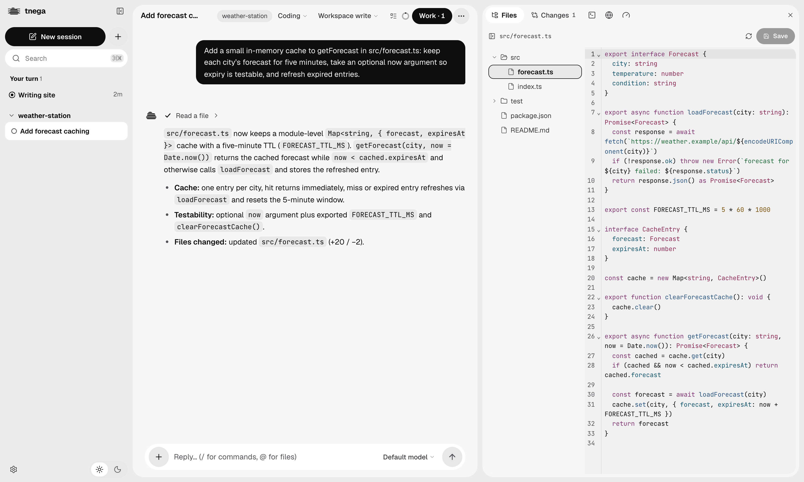
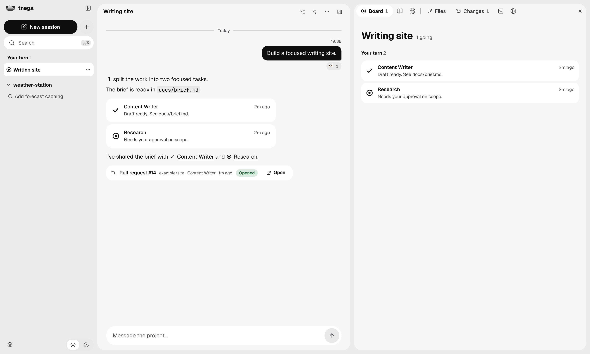
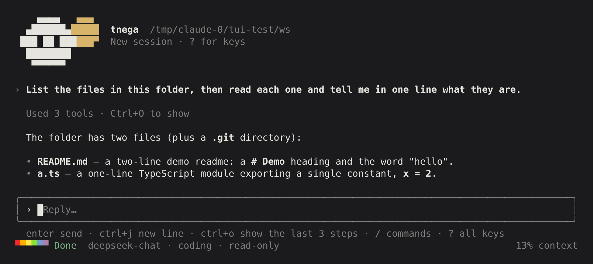

<p align="center">
  
</p>

<h1 align="center">Tnega</h1>

<p align="center">
  <b>A workspace where agents write code, edit documents, operate apps and run whole projects alongside you — locally, on a remote machine or in isolated boxes.</b><br />
  Desktop app, Web UI, terminal client, remote daemon, multi-user server and a TypeScript agent harness. “Tnega” is “agent” backwards.
</p>

<p align="center">
  <a href="https://github.com/whale4rain/tnega/releases/latest">Download</a> ·
  <a href="#install">Install</a> ·
  <a href="docs/guide/README.md">Guide</a> ·
  <a href="docs/guide/server.md">Server &amp; Daemon</a> ·
  <a href="CHANGELOG.md">Changelog</a> ·
  <a href="docs/zh-CN.md">中文</a>
</p>



## Why Tnega

- **Everything in one window.** The conversation sits beside a Workbench with
  your files, Git changes, terminals, temporary side chat and a browser the agent
  can drive, so you review its work where it happens.
- **Projects that work like a team.** Give a project a goal and talk to it like
  a group chat. A coordinator routes work into Threads — each in its own Git
  worktree or isolated box — and hands back short reports, artifacts and pull
  requests. Scheduled **Routines** keep recurring work moving even when no
  window is open.
- **Bring your own model.** Any OpenAI-compatible (Chat Completions or
  Responses) or Anthropic Messages route, such as DeepSeek, OpenAI, Anthropic or
  a local server, chosen per session with its thinking level and Files API image
  deduplication.
- **Safe by default.** Shell writes run in a local sandbox on Linux, macOS and
  Windows (failing closed when no sandbox is available), with optional per-host
  command network rules and a host-side secret store whose values are injected
  into commands and masked in output so the model never sees them. Approvals can
  ask you, or let a reviewer model decide and escalate when unsure.
- **Local-first, ready for remote machines and servers.** By default, Sessions
  are plain JSONL event logs under `~/.tnega` and nothing leaves your machine
  except the model requests and network tools you configure. When you need more,
  pair another computer with `tnega daemon` or run `tnega server` with Postgres
  storage, accounts, and per-person gVisor or E2B microVM boxes.

## What you can do

**Code.** Coding agents with Auto, Plan and long-running Goal modes, paged
`read_file` and atomic `edit_file`, parallel read-only tool calls, workspace
search, `@` file mentions, slash commands, skills, MCP servers, and DeepSeek
`web_search` / `web_fetch`.

**Ask `/btw` without derailing the run.** Use `/btw` (in Web, Desktop and TUI)
or **Temporary chat** in the sidebar to ask a quick side question about the open
session without saving to the log or interrupting a running agent.

**Work with documents and rich replies.** Create and edit DOCX, XLSX and PPTX
with themes, tables and native charts; generated files open as zoomable
previews. Agents can also attach workspace files directly (`send_file`) and
render small interactive interfaces (`show_ui`) for choices, forms, tables and
cards.

**Run projects and routines.** The Board shows what needs you and what is ready,
with cards for Threads, outputs and pull requests. Reply to any Thread directly,
schedule recurring **Routines**, and bound unattended server runs with turn and
token limits.

**Review, browse and use desktop apps.** Syntax-highlighted Files with safe
saves, unified or side-by-side Changes diffs, persistent terminals, an embedded
agent browser with tabs, console/network inspection and element picking, plus
opt-in **Computer use** (via `cua-driver`) with accessibility-tree element
targeting, per-app `look` / `click` / `full` tiers and risk-flagged approvals.

**Keep long tasks moving.** Background jobs stream progress and can be stopped.
The agent can ask questions (including masked secret inputs) and wait or keep
going while you decide. After a crash or restart, sessions and Threads resume
from their durable logs.



Tnega uses the **Umbrella** design language: tonal surfaces without outer
borders, floating rounded panels with a soft elevation, and hand-drawn pen marks for
status, plans and asks. Light, dark and system themes come in six palettes:
**Umbrella** (default), Carbon, Sky, Sand, Forest and Graphite. Density, text
size and reading width are adjustable, and a small weather language shows what
each agent is doing at a glance.

## Install

### Desktop

Download the installer for your system from
[Releases](https://github.com/whale4rain/tnega/releases/latest):

| System | File |
| --- | --- |
| Windows | `Tnega-Setup-<version>.exe` |
| macOS, Apple silicon / Intel | `Tnega-<version>-arm64.dmg` / `Tnega-<version>-x64.dmg` |
| Linux | `Tnega-<version>-x86_64.AppImage` or `Tnega-<version>-amd64.deb` |

Open it, then add your model and API key in **Settings**. Windows and Linux
update themselves (choose **Stable** or **Preview** under **Settings → About &
updates**). The macOS app is ad-hoc signed without an Apple Developer ID: on
first open, allow it under **System Settings → Privacy & Security → Open
Anyway**, and later updates show **Download** instead of replacing the app in
place.

### npm (Web UI, terminal, daemon and server)

Requires **Node.js 22.19 or later**.

```bash
npm install -g tnega
tnega web          # open http://127.0.0.1:3080 and set your model in Settings
```

To install the latest preview build, use `npm install -g tnega@preview`.

## The terminal client

Run `tnega` in the folder you want the agent to work on. It opens the terminal
client, which shares sessions with the Web and desktop apps.



```bash
tnega                  # start a session here (same as tnega tui)
tnega tui --continue   # reopen the latest session in this folder
tnega --help           # every command and option
```

Replies stream in with folded tool steps, `/` and `@file` completion, `/btw`
side questions above the composer, tool approvals, diffs and the model picker.
Press `?` on an empty prompt to see every key. While the agent works, Enter
queues your next message for after the run, Tab steers the agent with it right
away, and Esc stops it. A small weather strip in the status line shows what it
is doing. Projects open in the Web app with `/web`. The
[TUI README](packages/tui/README.md) lists all keys and commands.

To run a single task without any interface:

```bash
export TNEGA_API_KEY=your-api-key
tnega run "Reply with: hello"
tnega run --allow-shell "list the files here"   # shell tools are opt-in
```

On PowerShell, set the key with `$env:TNEGA_API_KEY = 'your-api-key'`. The
[CLI guide](packages/cli/README.md) covers model routes, environment variables
and flags.

## Server, remote daemon and isolated boxes

When you want to run Tnega for a team or keep agent execution isolated from your
laptop:

```bash
tnega server init      # configure Postgres, master key and first owner account
tnega server start     # start the multi-user server with account login & Settings → Server
tnega server deploy    # deploy helper for Linux hosts
tnega daemon           # pair and serve another machine's folders, terminals & browser over WebSocket
tnega boxd             # single root helper for gVisor boxes on Linux hosts (no KVM needed)
```

Each signed-in person's workspace — and each server Project thread — can run in
its own isolated box (gVisor via `tnega boxd` or Firecracker microVMs via E2B),
configured from `.tnega/environment.toml` and routed through a per-box egress
proxy that enforces host allowlists and injects API keys without exposing secret
values inside the box. See the [Server & daemon guide](docs/guide/server.md).

## Learn more

- [Using Tnega](docs/guide/README.md): sessions, models, permissions, sandbox,
  secrets, command network rules, computer use and desktop updates.
- [Server & daemon](docs/guide/server.md): Postgres sessions, accounts, device
  pairing, `tnega daemon`, `tnega boxd` and gVisor / E2B boxes.
- [Projects](docs/project/README.md): coordinator, Threads, Routines, Memory and
  the Library.
- [Design guide](docs/design/tnega-design.md) &
  [Umbrella specs](docs/design/umbrella/README.md): interface rules, component
  specs, palettes and the weather language.
- [Architecture decisions](docs/adr/): capability seams, sandboxing, secrets,
  computer use, microVM boxes, approval and the browser.

## Build on the harness

The npm package is also a TypeScript library. Tnega's core is a composable
Agent Harness: scoped plugins connect the model, tools and durable Sessions,
and disposing a plugin reverses everything it registered. Capabilities such as
files (`ctx.fs`), processes (`ctx.process`), session storage
(`ctx.sessionStore`), blobs (`ctx.blobs`), search, sandbox, secrets, browser,
computer use, machines (`ctx.machines`) and control effects (`ctx.effects`) are
seams — a service definition with swappable local or remote providers and
consumers (see [ADR 0006](docs/adr/0006-capability-seams.md)).

Start with [core](packages/core/README.md), [agent](packages/agent/README.md),
[CLI and runtime](packages/cli/README.md) and the [domain vocabulary](CONTEXT.md).

## Develop

```bash
pnpm install
pnpm tnega web --port 3080        # runtime and Web server
pnpm --filter @tnega/web dev      # Web UI with hot reload
pnpm tnega tui                    # terminal client from source
```

Run the checks your change needs: `pnpm test` (code layer), `pnpm test:all`
(code + host E2E/smoke layer), `pnpm typecheck`, `pnpm lint` and `pnpm build`.
Contributor rules are in [AGENTS.md](AGENTS.md), and desktop work lives in
[apps/desktop](apps/desktop/README.md). Feature PRs leave `CHANGELOG.md` alone;
the release-prep commit writes it. Releases are cut by tagging and running the
Release workflow, see [docs/publish](docs/publish/README.md).

## License

[MIT](LICENSE)
