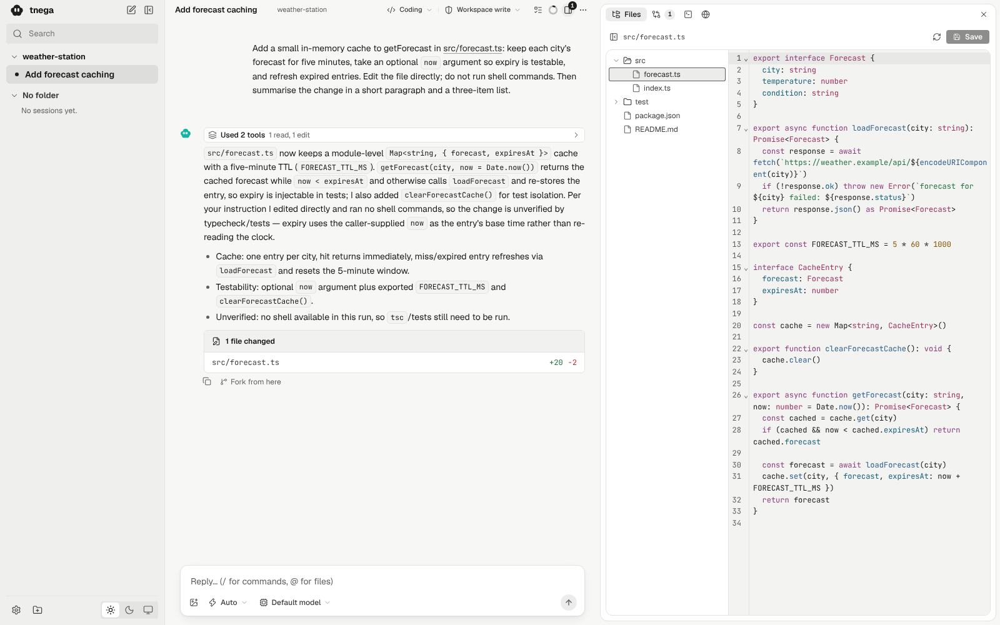
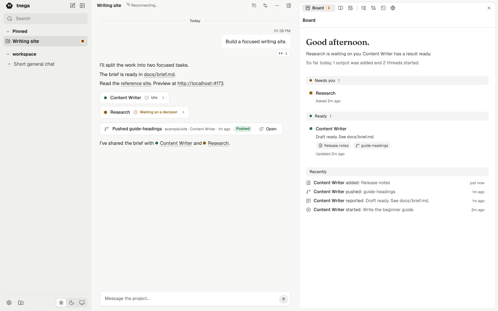
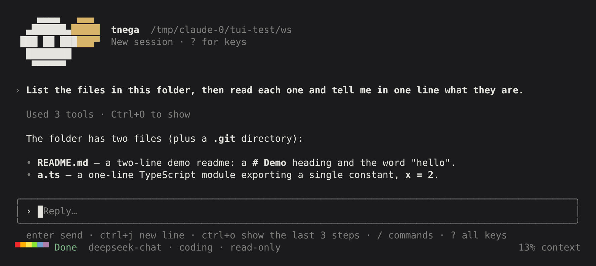

<p align="center">
  
</p>

<h1 align="center">Tnega</h1>

<p align="center">
  <b>一个本地工作空间：Agent 在你身边写代码、改文档、推进整个项目。</b><br />
  桌面应用、Web 界面、终端客户端，以及一个 TypeScript Agent Harness。Tnega 是 agent 的倒写。
</p>

<p align="center">
  <a href="https://github.com/whale4rain/tnega/releases/latest">下载</a> ·
  <a href="#安装">安装</a> ·
  <a href="guide/README.md">使用指南</a> ·
  <a href="../CHANGELOG.md">更新记录</a> ·
  <a href="../README.md">English</a>
</p>



## 为什么用 Tnega

- **一切在一个窗口里。** 对话旁边是工作台：文件、Git 改动、终端，以及 Agent 能操作的浏览器。Agent 在哪里干活，你就在哪里审阅。
- **像团队一样运转的项目。** 给项目一个目标，像在群聊里一样和它说话。协调者把每个请求分到独立的 Thread；每个 Thread 在自己的 Git worktree 里工作，交回一份简短报告或一个拉取请求。
- **自带模型。** 任何 OpenAI 兼容或 Anthropic Messages 路由，例如 DeepSeek、OpenAI、Anthropic 或本地服务；每个会话可单独选择模型与思考强度。
- **默认安全。** Linux、macOS 和 Windows 上，shell 写入在本机沙箱中运行；没有可用沙箱时，Tnega 拒绝执行受限命令。审批可以问你，也可以交给审阅模型决定，拿不准时再问你。
- **数据留在本地。** 会话是 `~/.tnega` 下的 JSONL 事件日志。除了你配置的模型请求和你开启的网络工具，没有任何东西离开你的电脑。

## 能做什么

**写代码。** Coding Agent 支持 Auto、Plan 和长时间运行的 Goal 模式，带工作区搜索、文件工具、`@` 文件引用、斜杠命令、技能和 MCP 服务。

**处理文档。** 创建和编辑 DOCX、XLSX、PPTX，支持主题、表格和原生图表。生成的文件显示为可缩放、可下载的预览。

**推进项目。** Board 用一句话说明什么在等你、什么已经完成，并列出 Thread、产物和拉取请求的卡片。你可以直接回复任何 Thread；协调者发给 Thread 的说明会折叠显示在该 Thread 的对话里。

**审阅与浏览。** 带语法高亮、安全保存的文件编辑器，统一或并排的 diff，切换标签后依然保留的终端，以及支持多标签、截图、控制台与网络查看和元素选择器的 Agent 浏览器。

**让长任务继续跑。** 后台任务显示进度并可停止。Agent 可以提问并等你回答，也可以在你考虑时继续工作。崩溃或重启后，会话与 Thread 会从中断处继续。



浅色、深色与跟随系统主题有五套调色板：默认的 Carbon（平静的中性灰），以及 Sky、Sand、Forest 和 Graphite。密度、字号和对话宽度都可以调整。一套小小的天气语言让你一眼看出每个 Agent 在做什么。

## 安装

### 桌面端

从 [Releases](https://github.com/whale4rain/tnega/releases/latest) 下载对应系统的安装包：

| 系统 | 文件 |
| --- | --- |
| Windows | `Tnega-Setup-<版本>.exe` |
| macOS（Apple 芯片 / Intel） | `Tnega-<版本>-arm64.dmg` / `Tnega-<版本>-x64.dmg` |
| Linux | `Tnega-<版本>-x86_64.AppImage` 或 `Tnega-<版本>-amd64.deb` |

打开后在 **Settings** 中添加模型和 API Key。Windows 与 Linux 版会自动更新：启动时及每四小时检查一次，后台下载后显示 **Update**，点击即可安装并重启；也可以在 **Settings → Check for updates** 手动检查。**Settings → Update channel** 可选默认的 Stable 或 Preview（接收 `x.y.z-beta.N` 预览版）。

macOS 版没有 Apple Developer ID 签名：第一次打开时在 **系统设置 → 隐私与安全性** 中选择 **仍要打开**；之后有新版本时显示 **Download**，引导你下载新安装包，而不是原地更新。Linux 的可执行文件名是 `tnega-desktop`，不会与 npm 安装的 `tnega` 命令冲突。

### npm（Web 界面与终端）

需要 **Node.js 22.19 或更高版本**。

```bash
npm install -g tnega
tnega web          # 然后打开 http://127.0.0.1:3080，在 Settings 中配置模型
```

更新使用 `npm install -g tnega@latest`。

## 终端客户端

在要让 Agent 处理的文件夹里运行 `tnega`，就会打开终端客户端。它与 Web 和桌面应用共用会话。



```bash
tnega                  # 在这里开始会话（同 tnega tui）
tnega tui --continue   # 打开这个文件夹最近的会话
tnega --help           # 所有命令与选项
```

回复以流式显示，工具步骤自动折叠，支持 `/` 与 `@文件` 补全、工具审批、diff 和模型选择。在空输入框按 `?` 查看全部按键。Agent 工作时，Enter 把下一条消息排到本轮结束后，Tab 立即用它引导 Agent，Esc 停止。状态栏里的小天气条表示它正在做什么。Project 用 `/web` 在 Web 应用中打开。按键与命令见 [TUI README](../packages/tui/README.md)。

不带任何界面执行单个任务：

```bash
export TNEGA_API_KEY=your-api-key
tnega run "回复：hello"
tnega run --allow-shell "列出这里的文件"   # shell 工具需显式开启
```

PowerShell 使用 `$env:TNEGA_API_KEY = 'your-api-key'`。配置文件在 Windows 的 `%USERPROFILE%\.tnega\config.json`，Linux / macOS 的 `~/.config/tnega/config.json`。模型路由、环境变量和参数见 [CLI 指南](../packages/cli/README.md)。

## 数据在哪里

桌面、Web、CLI、子代理与 Project Thread 的会话保存在 `~/.tnega/sessions/<workspace-key>/`，Project 消息与身份信息保存在 `~/.tnega/workspaces/<workspace-key>/`。key 来自工作区绝对路径的哈希；可用 `TNEGA_HOME` 改变用户数据根目录。项目配置、技能、记忆与产物留在工作区里。

用户记忆在 `~/.tnega/MEMORY.md`，工作区记忆在 `.tnega/MEMORY.md`。没有选择文件夹的新会话在 `~/.tnega/scratch` 中运行。0.5.0 写入的会话保存了模型的推理内容，0.4.24 及更早版本无法打开。

## 了解更多

- [使用指南](guide/README.md)：会话、模型、权限与沙箱、数据位置、技能和桌面更新。
- [Projects](project/README.md)：协调者、Thread、Memory 与 Library 如何配合。
- [设计规范](design/tnega-design.md)：界面规则、颜色与天气语言。
- [架构决策](adr/)：持久化、沙箱、审批、CodeMode 与浏览器。

## 基于 Harness 开发

npm 包同时是一个 TypeScript 库。Tnega 的核心是可组合的 Agent Harness：有作用域的插件连接模型、工具与持久化 Session，销毁插件时会撤销它注册的一切。搜索、沙箱、浏览器等能力是「缝」：一个 Service Definition，配上可替换的 Provider 与 Consumer，依赖方向见 [ADR 0006](adr/0006-capability-seams.md)。

从[核心](../packages/core/README.md)、[Agent](../packages/agent/README.md)、[CLI 与 runtime](../packages/cli/README.md) 和[领域术语](../CONTEXT.md)开始读。

## 参与开发

```bash
pnpm install
pnpm tnega web --port 3080        # runtime 与 Web 服务
pnpm --filter @tnega/web dev      # 热更新的 Web 界面
pnpm tnega tui                    # 从源码运行终端客户端
```

按改动范围运行 `pnpm test`、`pnpm typecheck`、`pnpm lint` 和 `pnpm build`。贡献规则见 [AGENTS.md](../AGENTS.md)，桌面端开发见 [apps/desktop](../apps/desktop/README.md)。功能与修复 PR 不改 `CHANGELOG.md`，由发布准备 PR 统一写入。推送版本 tag 即发布，流程见[发布指南](publish/README.md)。

## License

[MIT](../LICENSE)
