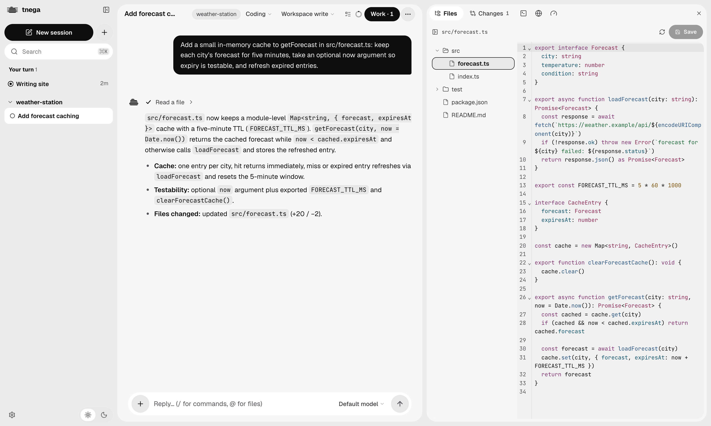
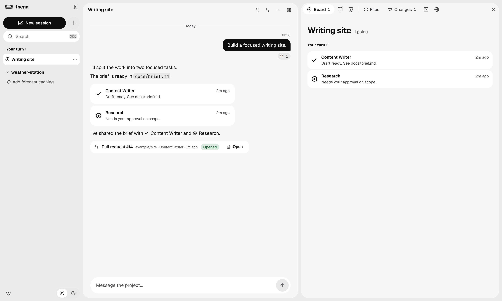
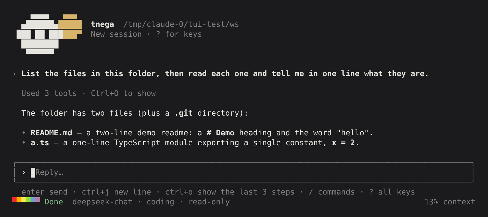

<p align="center">
  
</p>

<h1 align="center">Tnega</h1>

<p align="center">
  <b>一个与你并肩写代码、改文档、操作桌面应用并推进整个项目的 Agent 工作空间——支持本机、远端机器与隔离 Box。</b><br />
  桌面应用、Web 界面、终端客户端、远端 Daemon、多用户服务端，以及一个 TypeScript Agent Harness。Tnega 是 agent 的倒写。
</p>

<p align="center">
  <a href="https://github.com/whale4rain/tnega/releases/latest">下载</a> ·
  <a href="#安装">安装</a> ·
  <a href="guide/README.md">使用指南</a> ·
  <a href="guide/server.md">服务端与 Daemon</a> ·
  <a href="../CHANGELOG.md">更新记录</a> ·
  <a href="../README.md">English</a>
</p>



## 为什么用 Tnega

- **一切在一个窗口里。** 对话旁边是工作台：文件、Git 改动、终端、临时旁白对话，以及 Agent 可操作的浏览器。Agent 在哪里干活，你就在哪里审阅。
- **像团队一样运转的项目。** 给项目一个目标，像在群聊里一样和它说话。协调者把任务分派到独立的 Thread——每个 Thread 在自己的 Git worktree 或隔离 Box 中运行，交回简短报告、产物与 Pull Request。定时 **Routine** 在没有打开窗口时也能按计划持续运转。
- **自带模型。** 任何 OpenAI 兼容（Chat Completions / Responses）或 Anthropic Messages 路由，如 DeepSeek、OpenAI、Anthropic 或本地服务；每个会话可单独选择模型与思考强度，并支持通过 Files API 对截图和图片去重上传。
- **默认安全。** Linux、macOS 和 Windows 上，shell 写入在本机沙箱中运行，无可用沙箱时拒绝降级执行（fail closed）；支持按域名控制命令网络访问，并内置宿主侧 Secret 存储——密钥只以环境变量注入命令并在输出中自动脱敏，模型永远看不到明文。审批既可手动确认，也可交由审阅模型自动判断并在不确定时询问你。
- **本地优先，同时支持远端与多用户服务。** 默认情况下，会话以纯 JSONL 事件日志保存在 `~/.tnega`，除你配置的模型请求与开启的网络工具外，不离开你的电脑。需要跨设备或团队协作时，可用 `tnega daemon` 接入另一台机器，或用 `tnega server` 部署带 Postgres 存储、账号角色与每用户隔离 Box（gVisor / E2B）的服务端。

## 能做什么

**写代码。** Coding Agent 支持 Auto、Plan 和长周期 Goal 模式，具备按行分页的 `read_file` 与原子写入的 `edit_file`、只读工具并行执行、工作区搜索、`@` 文件引用、斜杠命令、技能、MCP 服务，以及基于 DeepSeek Search API 的 `web_search` / `web_fetch`。

**随时 `/btw` 旁白提问。** 在 Web、桌面端或 TUI 中用 `/btw`，或从侧栏打开 **Temporary chat**，针对当前会话问一个临时问题，不写入会话日志，也不打断正在运行的 Agent。

**处理文档与富交互回复。** 创建和编辑 DOCX、XLSX、PPTX（支持主题、表格与原生图表），生成结果可缩放预览与下载。Agent 还可以用 `send_file` 直接在回复中附带工作区文件，或用 `show_ui` 渲染选项、表单、表格与卡片等轻量交互界面。

**推进项目与定时 Routine。** Board 清晰展示什么在等你、什么已完成，汇总 Thread、产物与 PR 卡片。你可以直接回复任何 Thread，配置定时执行的 **Routine**，并通过无人值守轮次与 token 上限防止服务端后台任务失控。

**审阅、浏览与桌面操作。** 带语法高亮和安全保存的文件编辑器、统一或并排的 Changes diff、持久终端、内置多标签 Agent 浏览器（含截图、控制台/网络查看与元素选择器），以及默认关闭、按需开启的 **Computer use**（经 `cua-driver`）：支持无障碍树元素定位、按应用设置 `look` / `click` / `full` 权限分级，以及带风险说明的审批。

**让长任务持续推进。** 后台任务实时展示进度并可随时停止。Agent 可以向你提问（含掩码密钥输入）并等待或继续推进。崩溃或重启后，会话与 Thread 从持久化日志中无缝恢复。



界面采用 **Umbrella** 设计语言：无外框的色调层级、带柔和高度的圆角悬浮面板，以及用手工笔迹（`PenMark`）标出状态、计划与待确认事项。浅色、深色与跟随系统主题提供六套调色板：**Umbrella**（默认）、Carbon、Sky、Sand、Forest 与 Graphite。密度、字号与阅读宽度均可调节，一套天气状态语言让你一眼看出每个 Agent 在做什么。

## 安装

### 桌面端

从 [Releases](https://github.com/whale4rain/tnega/releases/latest) 下载对应系统的安装包：

| 系统 | 文件 |
| --- | --- |
| Windows | `Tnega-Setup-<版本>.exe` |
| macOS（Apple 芯片 / Intel） | `Tnega-<版本>-arm64.dmg` / `Tnega-<版本>-x64.dmg` |
| Linux | `Tnega-<版本>-x86_64.AppImage` 或 `Tnega-<版本>-amd64.deb` |

打开后在 **Settings** 中添加模型和 API Key。Windows 与 Linux 支持自动更新（可在 **Settings → About & updates** 切换 Stable 或 Preview 通道）。macOS 版为 ad-hoc 签名：首次打开请在 **系统设置 → 隐私与安全性** 中选择 **仍要打开**，后续有新版本时显示 **Download** 引导下载覆盖安装。

### npm（Web 界面、终端、Daemon 与服务端）

需要 **Node.js 22.19 或更高版本**。

```bash
npm install -g tnega
tnega web          # 打开 http://127.0.0.1:3080，在 Settings 中配置模型
```

如需体验预览版，可安装 `npm install -g tnega@preview`。

## 终端客户端

在要让 Agent 工作的文件夹里运行 `tnega`，即可打开终端客户端，与 Web 和桌面应用共用会话。



```bash
tnega                  # 在这里开始会话（同 tnega tui）
tnega tui --continue   # 打开这个文件夹最近的会话
tnega --help           # 所有命令与选项
```

回复流式输出，工具步骤自动折叠，支持 `/` 与 `@文件` 补全、输入框上方展示 `/btw` 临时回答、工具审批、diff 和模型选择。空输入框按 `?` 查看全部快捷键。Agent 运行时，Enter 将下一条消息排到本轮结束后，Tab 立即引导当前执行，Esc 停止。状态栏天气条反映当前状态，Project 可用 `/web` 在 Web 端打开。完整说明见 [TUI README](../packages/tui/README.md)。

不带界面执行单个任务：

```bash
export TNEGA_API_KEY=your-api-key
tnega run "回复：hello"
tnega run --allow-shell "列出这里的文件"   # shell 工具需显式开启
```

PowerShell 使用 `$env:TNEGA_API_KEY = 'your-api-key'`。模型路由、环境变量与参数见 [CLI 指南](../packages/cli/README.md)。

## 服务端、远端 Daemon 与隔离 Box

当你需要多人协作或将 Agent 执行环境与本机彻底隔离时：

```bash
tnega server init      # 初始化 Postgres、主密钥与首个 Owner 账号
tnega server start     # 启动多用户服务端（带登录与 Settings → Server 管理页）
tnega server deploy    # Linux 主机部署辅助命令
tnega daemon           # 通过 WebSocket 把另一台机器的目录、终端与浏览器接入 Tnega
tnega boxd             # Linux 主机上 gVisor Box 的唯一 root 辅助进程（无需 KVM）
```

每个登录用户的工作区以及服务端 Project 的每个 Thread 都可以运行在独立 Box 中（基于 `tnega boxd` 的 gVisor 或 E2B Firecracker microVM），通过 `.tnega/environment.toml` 定义环境，并经由每 Box 专属的 egress proxy 放行允许的主机与注入 API Key，Box 内不落盘任何密钥明文。详见[服务端与 Daemon 指南](guide/server.md)。

## 了解更多

- [使用指南](guide/README.md)：会话、模型、权限与沙箱、Secrets、命令网络规则、Computer use 与桌面更新。
- [服务端与 Daemon](guide/server.md)：Postgres 会话、账号角色、设备配对、`tnega daemon`、`tnega boxd` 与 gVisor / E2B Box。
- [Projects](project/README.md)：协调者、Thread、Routine、Memory 与 Library 的协作方式。
- [设计规范](design/tnega-design.md) 与 [Umbrella 组件规范](design/umbrella/README.md)：界面规则、组件细节、调色板与天气语言。
- [架构决策](adr/)：能力缝、沙箱、Secrets、Computer use、microVM Box、审批与浏览器。

## 基于 Harness 开发

npm 包同时是一个 TypeScript 库。Tnega 的核心是可组合的 Agent Harness：有作用域的插件连接模型、工具与持久化 Session，销毁插件时会按逆序撤销它注册的一切。文件（`ctx.fs`）、进程（`ctx.process`）、会话存储（`ctx.sessionStore`）、Blob（`ctx.blobs`）、搜索、沙箱、Secrets、浏览器、Computer use、Box 机器（`ctx.machines`）与控制循环（`ctx.effects`）均为能力缝——一个 Service Definition 配上可替换的本机或远端 Provider 与 Consumer（见 [ADR 0006](adr/0006-capability-seams.md)）。

可从[核心](../packages/core/README.md)、[Agent](../packages/agent/README.md)、[CLI 与 runtime](../packages/cli/README.md) 和[领域术语](../CONTEXT.md)开始阅读。

## 参与开发

```bash
pnpm install
pnpm tnega web --port 3080        # runtime 与 Web 服务
pnpm --filter @tnega/web dev      # 热更新的 Web 界面
pnpm tnega tui                    # 从源码运行终端客户端
```

按改动范围运行 `pnpm test`（代码层）、`pnpm test:all`（代码层 + 宿主 E2E/smoke 层）、`pnpm typecheck`、`pnpm lint` 和 `pnpm build`。贡献规则见 [AGENTS.md](../AGENTS.md)，桌面端开发见 [apps/desktop](../apps/desktop/README.md)。功能与修复 PR 不改 `CHANGELOG.md`，由发布准备提交统一写入；发布流程见[发布指南](publish/README.md)。

## License

[MIT](../LICENSE)
